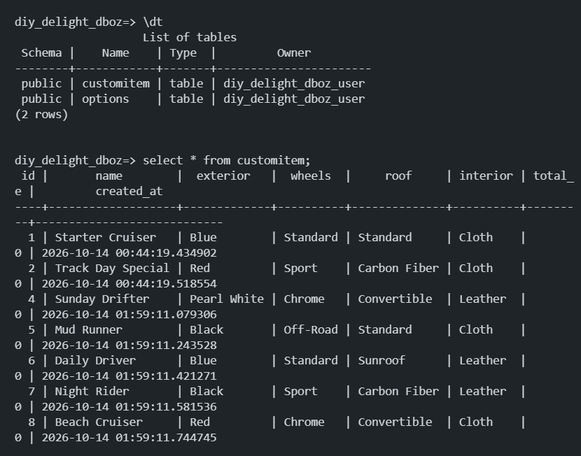
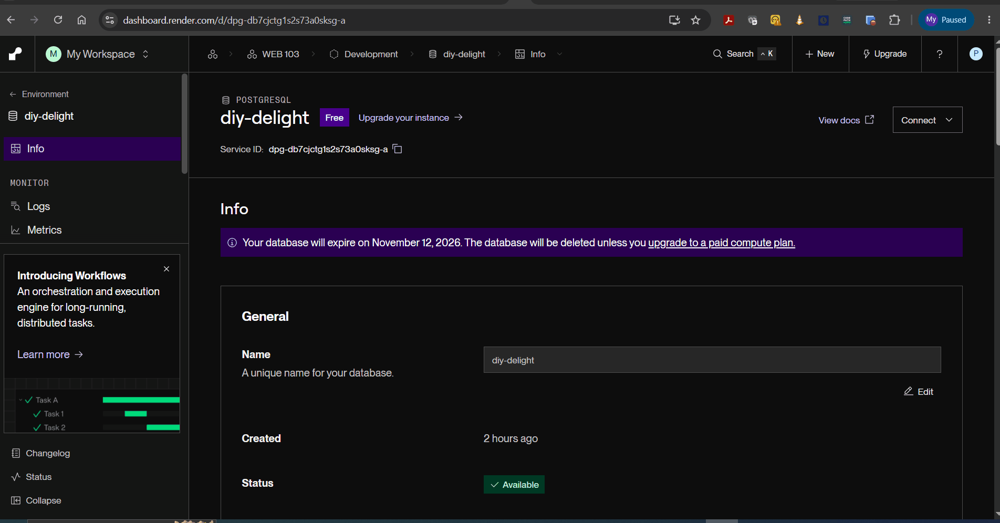
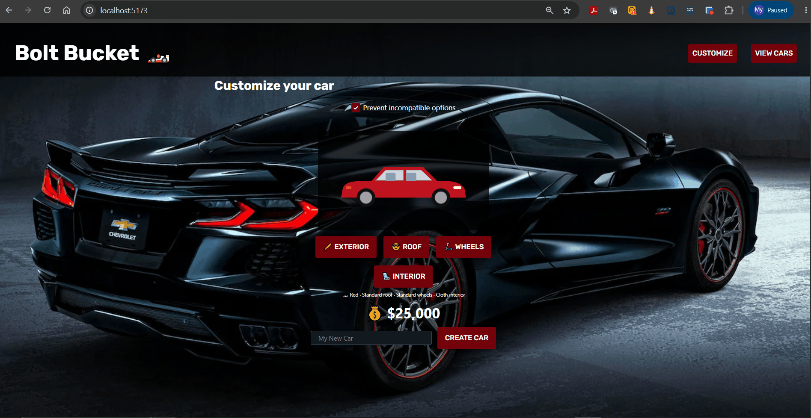

# WEB103 Project 4 - *Bolt Bucket*

Submitted by: **My Pham**

About this web app: **Bolt Bucket is a car customizer. Users pick an exterior color, wheels, roof and interior, watch a live preview and price update as they choose, and save the finished car to a Postgres database. Saved cars can be viewed, edited and deleted. Impossible feature combinations are rejected with an error message.**

Time spent: **2** hours

## Required Features

The following **required** functionality is completed:

<!-- Make sure to check off completed functionality below -->
- [x] **The web app uses React to display data from the API.**
- [x] **The web app is connected to a PostgreSQL database, with an appropriately structured `CustomItem` table.**
  - [x]  **NOTE: Your walkthrough added to the README must include a view of your Render dashboard demonstrating that your Postgres database is available**
  - [x]  **NOTE: Your walkthrough added to the README must include a demonstration of your table contents. Use the psql command 'SELECT * FROM tablename;' to display your table contents.**
- [x] **Users can view **multiple** features of the `CustomItem` (e.g. car) they can customize, (e.g. wheels, exterior, etc.)**
- [x] **Each customizable feature has multiple options to choose from (e.g. exterior could be red, blue, black, etc.)**
- [x] **On selecting each option, the displayed visual icon for the `CustomItem` updates to match the option the user chose.**
- [x] **The price of the `CustomItem` (e.g. car) changes dynamically as different options are selected *OR* The app displays the total price of all features.**
- [x] **The visual interface changes in response to at least one customizable feature.**
- [x] **The user can submit their choices to save the item to the list of created `CustomItem`s.**
- [x] **If a user submits a feature combo that is impossible, they should receive an appropriate error message and the item should not be saved to the database.**
- [x] **Users can view a list of all submitted `CustomItem`s.**
- [x] **Users can edit a submitted `CustomItem` from the list view of submitted `CustomItem`s.**
- [x] **Users can delete a submitted `CustomItem` from the list view of submitted `CustomItem`s.**
- [x] **Users can update or delete `CustomItem`s that have been created from the detail page.**


The following **optional** features are implemented:

- [x] Selecting particular options prevents incompatible options from being selected even before form submission

The following **additional** features are implemented:

- [x] A live SVG car preview that changes body color, wheel style, roof (standard, sunroof, carbon fiber or open-top convertible) and seat color
- [x] An itemized price breakdown (base price plus each chosen option) next to the preview
- [x] A "Prevent incompatible options" checkbox. With it on, choosing a conflicting option shows a "NOPE!" popup and the option is not selected; with it off, you can submit a conflicting combo and see the error
- [x] The server recalculates the price and re-validates the combination on every create and update, so the client can't save a bad or mispriced car
- [x] Options are stored in their own `Options` table and served by `GET /api/options`
- [x] A `npm run reset` script that drops, recreates and seeds the tables

## How to Run

```
npm install
npm run reset   # drops and recreates the Options and CustomItem tables, then seeds them
npm run dev     # starts the Vite client (http://localhost:5173) and the Express API (http://localhost:3000)
```

The server reads its database connection from `server/.env`:

### API

| Method | Route | Description |
| --- | --- | --- |
| GET | `/api/options` | Base price, all options and the incompatibility rules |
| GET | `/api/cars` | List all cars |
| GET | `/api/cars/:id` | Get one car |
| POST | `/api/cars` | Create a car (400 if the combination is invalid) |
| PATCH | `/api/cars/:id` | Update a car (400 if the combination is invalid) |
| DELETE | `/api/cars/:id` | Delete a car |

## Video Walkthrough

Here's a walkthrough of implemented required features:

<!-- TODO: record the walkthrough. It must show:
     1. Your Render dashboard with the Postgres database available
     2. `SELECT * FROM CustomItem;` in psql showing the table contents
     3. Creating, viewing, editing and deleting a car, and the impossible-combo error -->




<!-- Replace this with whatever GIF tool you used! -->
GIF created with ScreenToGif
<!-- Recommended tools:
[Kap](https://getkap.co/) for macOS
[ScreenToGif](https://www.screentogif.com/) for Windows
[peek](https://github.com/phw/peek) for Linux. -->

## Notes

- **Impossible combinations:** the rules live in `server/data/options.js` and are returned by `GET /api/options`, so the client's validation and the server's validation use the same source. The rules are Convertible roof with Racing interior, Convertible roof with Off-Road wheels, and Carbon Fiber roof with Off-Road wheels.
- **Optional feature vs. required error message:** disabling incompatible options means a user can never submit a conflicting combo. I added the checkbox so the required error message can still be shown, and the server rejects bad combos anyway.
- **Pricing:** the displayed total is computed in `client/src/utilities/calcprice.js`, but the saved `total_price` is always recomputed on the server.
- **Starter code fixes:** the starter `server.js` used `app` before creating it, `reset.js` was empty and `.env` was loaded after the database pool was created, so those were fixed first.

## License

Copyright 2026 My Pham

Licensed under the Apache License, Version 2.0 (the "License"); you may not use this file except in compliance with the License. You may obtain a copy of the License at

> http://www.apache.org/licenses/LICENSE-2.0

Unless required by applicable law or agreed to in writing, software distributed under the License is distributed on an "AS IS" BASIS, WITHOUT WARRANTIES OR CONDITIONS OF ANY KIND, either express or implied. See the License for the specific language governing permissions and limitations under the License.